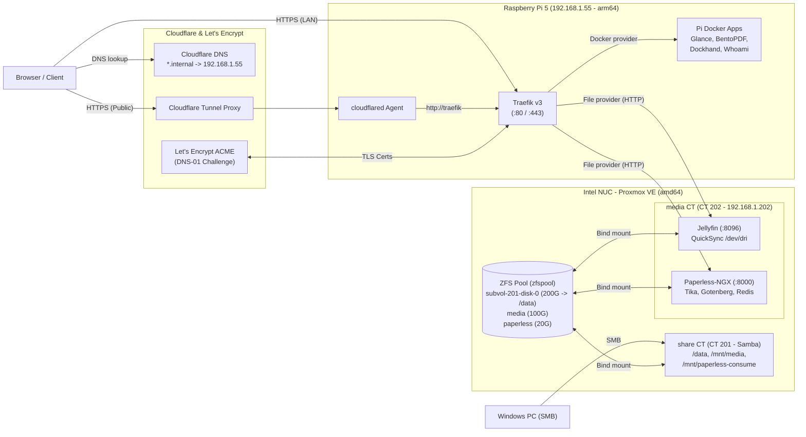

# Home Lab

Self-hosted homelab split across a **Raspberry Pi 5** (ingress, dashboard, lightweight tools) and an **Intel NUC** running **Proxmox VE** (media & document management), managed with Docker Compose and Traefik v3.

## Architecture



- **Reverse proxy & TLS**: Traefik v3 on the Pi handles TLS termination using Cloudflare DNS-01 ACME (`*.internal.anantagarwal.me`) and routes both local Pi containers (Docker provider) and NUC services (File provider → `192.168.1.202`).
- **DNS & Tunnel**: Cloudflare DNS resolves `*.internal.anantagarwal.me` to the Pi's LAN IP (`192.168.1.55`); `cloudflared` exposes select public services (such as `whoami.anantagarwal.me`) without opening router ports.
- **Compute & Storage**: `amd64` workloads (Jellyfin with Intel QuickSync, Paperless-NGX) run in the Proxmox `media` CT (CT `202`, `192.168.1.202`) backed by `zfspool` datasets shared with the `share` CT (CT `201`) for Windows drag-and-drop.

## Managing the Stack

A helper script `hl` manages both the Raspberry Pi and individual NUC Proxmox CTs (`hl pi <cmd>`, `hl media <cmd>`, or `hl <ct-name> <cmd>` for any `nuc/<ct-name>/compose.yaml`; omitting the target defaults to `pi`). Make it executable once:

```bash
chmod +x ~/homelab/hl

# Optional: symlink to PATH so you can run it from anywhere
sudo ln -sf ~/homelab/hl /usr/local/bin/hl
```

### Raspberry Pi (`hl pi` or `hl`)

```bash
hl pi up               # start all Pi services
hl pi down             # stop all Pi services
hl pi restart          # stop + start with orphan cleanup
hl pi update           # pull latest images and restart

hl pi up glance        # start a single service
hl pi restart traefik  # restart a single service
hl pi logs traefik     # follow logs (Ctrl-C to stop)
hl pi status           # show all running containers
hl pi exec glance sh   # open a shell in a container
```

### Intel NUC — `media` CT (`hl media`)

See [nuc/media/README.md](nuc/media/README.md) for Proxmox LXC, ZFS bind-mount, Samba, and `/dev/dri` setup. Once provisioned, manage the `media` CT stack from inside CT `202` (`192.168.1.202`):

```bash
hl media up              # start Jellyfin & Paperless-NGX
hl media update          # pull latest images and restart
hl media logs jellyfin   # follow Jellyfin logs
hl media status          # show media CT container states
```

## Services

### Internet Exposed

| Service | Host | URL |
|---------|------|-----|
| Whoami (debug) | Pi 5 | [whoami.anantagarwal.me](https://whoami.anantagarwal.me) |

### Internal (`*.internal.anantagarwal.me`)

| Service | Host | URL | Description |
|---------|------|-----|-------------|
| Traefik | Pi 5 | [traefik.internal.anantagarwal.me](https://traefik.internal.anantagarwal.me) | Reverse proxy dashboard |
| Glance | Pi 5 | [home.internal.anantagarwal.me](https://home.internal.anantagarwal.me) | Homelab dashboard |
| BentoPDF | Pi 5 | [bentopdf.internal.anantagarwal.me](https://bentopdf.internal.anantagarwal.me) | Privacy-first PDF toolkit |
| Dockhand | Pi 5 | [dockhand.internal.anantagarwal.me](https://dockhand.internal.anantagarwal.me) | Docker management UI |
| Jellyfin | Intel NUC | [jellyfin.internal.anantagarwal.me](https://jellyfin.internal.anantagarwal.me) | Media server (Intel QuickSync) |
| Paperless-NGX | Intel NUC | [paperless.internal.anantagarwal.me](https://paperless.internal.anantagarwal.me) | Document management |

## Folder Structure

```text
homelab/
├── hl                           # Multi-host management CLI wrapper
├── pi/                          # Raspberry Pi 5 (arm64)
│   ├── compose.yaml             # Pi top-level orchestrator
│   ├── traefik/                 # Traefik + Cloudflare tunnel + whoami
│   │   ├── compose.yaml
│   │   ├── config/
│   │   │   ├── traefik.yaml     # static config (Docker + File providers)
│   │   │   └── dynamic/
│   │   │       └── nuc.yaml     # routes to NUC services (192.168.1.202)
│   │   └── certs/               # TLS certificates (gitignored)
│   ├── glance/                  # Glance dashboard
│   │   ├── compose.yaml
│   │   └── config/
│   │       └── glance.yml
│   ├── bentopdf/                # BentoPDF self-hosted
│   │   └── compose.yaml
│   └── dockhand/                # Dockhand Docker UI
│       └── compose.yaml
└── nuc/                         # Intel NUC (Proxmox VE CTs)
    └── media/                   # CT 202 (192.168.1.202)
        ├── README.md            # Proxmox LXC, ZFS, Samba & QuickSync guide
        ├── compose.yaml         # media CT orchestrator
        ├── jellyfin/
        │   └── compose.yaml
        └── paperless-ngx/
            ├── compose.yaml
            └── .env.example
```

## Secrets Setup

Services that require secrets use a `.env` file in their folder. Copy the example and fill in your values:

```bash
# Paperless-NGX (on NUC media CT) — requires secret key + admin credentials
cp nuc/media/paperless-ngx/.env.example nuc/media/paperless-ngx/.env
nano nuc/media/paperless-ngx/.env
```

> **Note:** `.env` files are gitignored and should never be committed.
